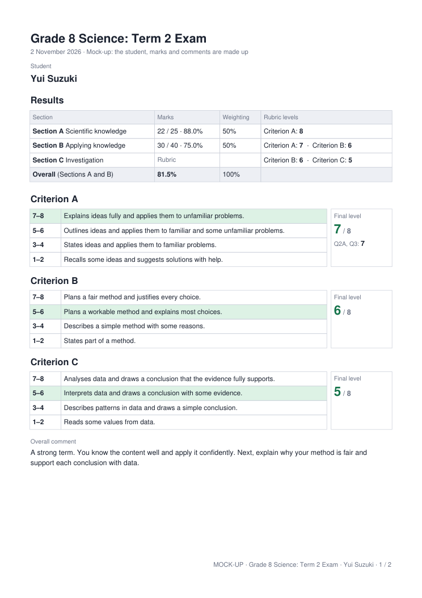
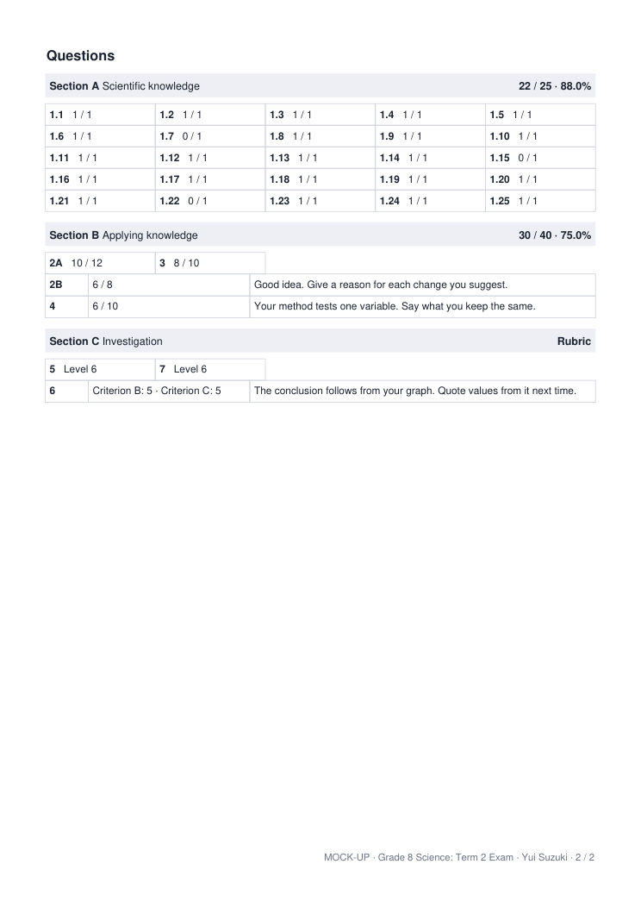
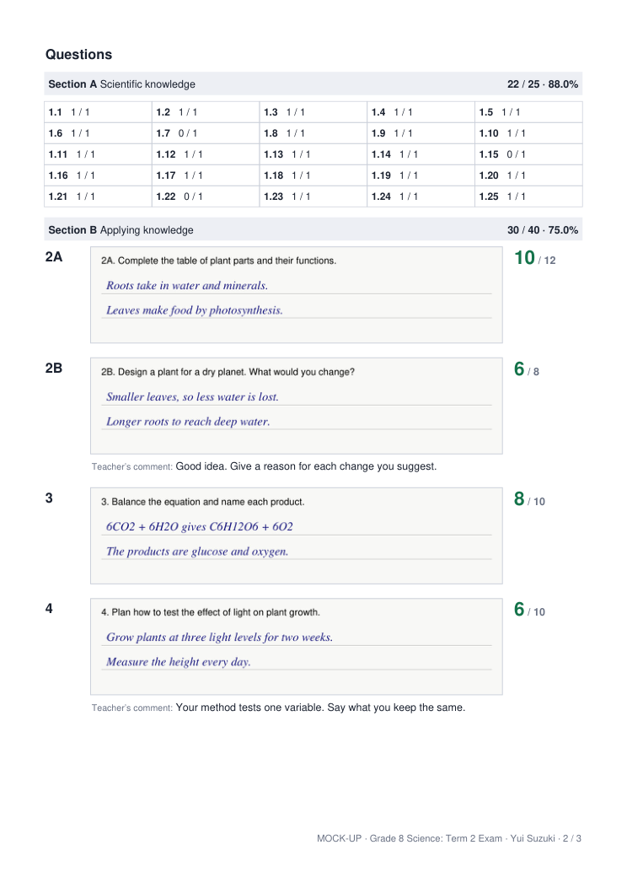
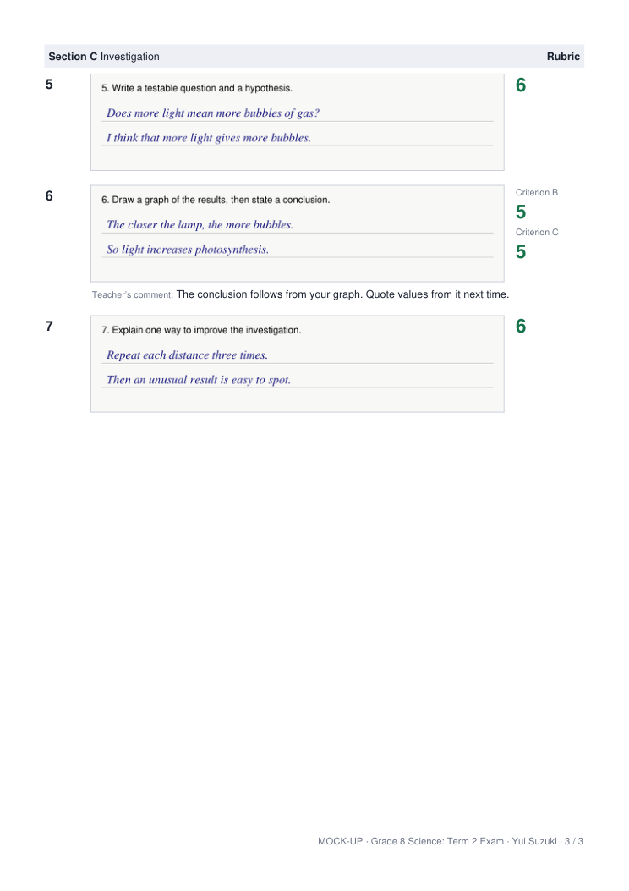

# CAM2 — Exam Sections & Report Options (Implementation Plan)

> **Status:** agreed design, not built yet (2026-11-02). It adds to [PLAN.md](PLAN.md); where the two differ, this plan wins once it is built.
> **Mock-up:** see §6. Everything in it is made up.

---

## 1. Goal

Many MYP exam papers are divided into sections. A section of multiple-choice questions is marked, its total becomes a percentage, and the teacher uses that to help decide a rubric level. Giving a rubric level to each multiple-choice question makes no sense.

So CAM2 should let a teacher:
- divide a paper into sections, each graded with marks or a rubric;
- decide rubric levels for any group of questions, just before making the reports;
- choose how much each section counts towards the final percentage;
- produce a clearer, shorter report that can leave out answer images.

**CAM2 stays simple.** It grades one exam at a time, with nothing that spans classes or assignments. Prefer what the app can work out for itself over a new setting, and hide anything that does not apply to this exam.

---

## 2. Teacher Flow

### Step ② Set up the questions
- **Sections are optional.** With none, the whole paper is one section and the screens look as they do today.
- **Adding one:** in the question list, **Start a new section here** adds a divider. Sections follow the order of the paper, so a question always sits inside one section. Moving a question past a divider moves it into that section.
- **Each section has:**
  - a name, which is optional (blank shows as `Section 1`);
  - **Marks** or **Rubric**.
- **Criteria are ticked per question, in both marks and rubric sections**, so one section can cover several criteria. A marks question only needs a tick if the teacher wants a rubric on the report.
- **Rubrics** can be entered in any exam. In an exam with only marks, they are optional and used only on the report.
- **A question is whatever the teacher draws a box around.** A printed "Question 1" of 24 multiple-choice items can be one question worth 24 marks, or 24 questions. A "Question 2" with parts A and B can be two questions. No separate "parts" feature is needed.
- **Choice questions** ("answer 2 of 3") must stay inside one section, because otherwise a section's total has no clear meaning.
- **Locks:** a section's marks or rubric choice is fixed once one of its questions has a grade. A graded question cannot move into a section of the other kind, because marks and levels cannot be converted.

### Step ④ Grade
- Each question shows marks buttons or rubric levels, according to its section. Otherwise this is unchanged.
- A rubric level given to one question is the decision for that question. Nothing needs deciding again in Step ⑤.

### Step ⑤ Review & export
All decisions that involve several questions happen here, just above the export.

**Rubric levels**
- Each level is a criterion plus the questions it covers.
- A **Final level** row per criterion used is always listed. It covers the whole paper.
- **+ Add a level:** choose a criterion and tick any questions.
- **One per section:** adds a level for each criterion used in each section, in one click. A level like this follows its section if questions move later.
- Each level adds one column to the review table. **Every level starts blank, and a blank level does not print.**
- Beside each cell is the evidence for that student, from the questions it covers: marks and percentage (`31 / 40 · 78%`), or the levels already given (`7, 7, 8`). Choice-group questions that did not count are left out. CAM2 shows no average.
- **Export warning:** if a level is filled in for some students but not others, the teacher is told which before the reports are made, because a blank no longer shows up on its own.

**Section percentages**
- **Count sections by percentage** is off by default, and the total is simply the marks added up.
- When on, each marks section gets a whole-number percentage, and these must add up to 100 before export. Rubric sections have none.
- The **Total on report** override then changes the final percentage instead of the marks total.

**Report options:** at most four, each hidden when it does not apply, and saved with the session. They apply to the whole class.

| Option | Shown when | Default |
|---|---|---|
| Section results | the exam has two or more sections | On |
| Overall total and percentage | the exam has marks questions | On |
| Rubric table | a criterion with descriptors is used | On |
| Answer images, one tick per section | always (one tick if there are no sections) | All on |

**See one report first** makes the PDF for the selected student, so the teacher can check it before making the whole class's reports.

---

## 3. Calculations

| Item | Rule |
|---|---|
| Section marks | The section's counted marks over its maximum, added up from its questions and never typed in. Choice groups count as they do today, inside their section. |
| Section percentage | Marks over maximum, shown to 1 decimal place. |
| Total, no weighting | All marks sections added together, shown as `52 / 65 · 80.0%`. |
| Total, with weighting | The sum of (section marks ÷ section maximum × weighting). It is worked out from unrounded figures and **rounded half up only once, at the end**. The report shows only the percentage, because it would not agree with a total out of 65. |
| Mixed paper | Rubric levels are never added to marks. The overall line says which sections it covers. |
| Rubric levels | **Always the teacher's decision.** CAM2 no longer averages a student's levels or suggests a final level, and this replaces the rubric rows in PLAN.md §3. Rules for ranking choice-group questions stay as they are. |
| Valid level | Must be a level in one of the rubric's bands, so the report can always shade the right band. |
| Ungraded question | Not counted, and the student is flagged incomplete, as today. |

**Why no average:** a level should be a best-fit judgement against the descriptors, not arithmetic. See §8.

**Example with weighting:** Section A 22 / 25 (88%) at 50% and Section B 30 / 40 (75%) at 50% gives 81.5%. Simply adding the marks gives 52 / 65, or 80%.

---

## 4. What is Saved

`cam2_session.json` gains:

```json
{
  "sections": [{"id": "sec1", "name": "Scientific knowledge", "mode": "marks", "weight": 50},
               {"id": "sec2", "name": "", "mode": "rubric", "weight": null}],
  "questions": [{"id": "q1", "section_id": "sec1", "rubric_ids": ["r1"]}],
  "levels": [{"id": "l1", "rubric_id": "r1", "section_id": "sec1"},
             {"id": "l2", "rubric_id": "r1", "questions": ["q2", "q4"]}],
  "weighted": true,
  "report_options": {"section_results": true, "overall_total": true,
                     "rubric_table": true, "no_images_for": ["sec1"]}
}
```

`grades.json` gains, under `overall.<student>`:

```json
{"decided_levels": {"l1": 7}, "report_percent": null}
```

- **`final_levels` stays** as the whole-paper level for each criterion. Only its meaning changes: blank now means no level, not "use the average".
- **Grades stay keyed by question and student ids**, so sections can change without a grade moving to another question or student.
- **Old sessions** have no `sections`. They read as one section using the existing `mode`, and open and grade as before. A final level the teacher did not type starts blank.
- **`model.VERSION` goes to 2**, so an older CAM2 refuses a session it would misread.
- **The wipe guard** (`model.grades_mass`) also counts decided and final levels, because they are now teacher work that nothing can recalculate.

---

## 5. Code Changes

| File | Change |
|---|---|
| `engine/model.py` | Document the new shapes, bump the version, extend `grades_mass`. |
| `engine/grading_summary.py` | Add `sections()` and `question_mode()`, and use `question_mode()` for every exam-wide `mode` check (`slots`, `set_grade`, `question_values`, `student_summary`, `class_summary`). Add per-section totals, weighting and `set_decided_level`. Remove `average`, `suggested` and the rubric `adjusted`. Choice groups must stay inside a section (`check_choice_groups`). `marks_maximum` works per section. `set_final_level` uses `rubrics.check_level`. |
| `engine/workflow.py` | Save sections, levels and options. Move the `mode_locked` check to each section, and refuse to move a graded question between section kinds. `check_ready` checks each question by its section's mode. |
| `engine/reports.py` | The new order and layout (§6), using a small drawn-table helper: MuPDF's HTML ignores table column widths. A rubric prints if any question ticks it, in marks or rubric sections. |
| `engine/gradebook_xlsx.py` | Add section marks, percentages and weightings, the decided and final levels, and the overall percentage. Remove the average columns. List sections and levels on the second sheet. Show the class average, maximum and minimum for each section. |
| `app.py` | Routes for sections, levels, weighting, report options and the one-report preview. |
| `static/js/step2.js`, `step4.js`, `step5.js`, `store.js` | The screens in §2. |
| `i18n/en.json`, `i18n/ja.json` | Every new string in both languages. |

Nothing here adds a dependency or a bundled file, so packaging is unaffected.

---

## 6. The Report

Printed in this order:
1. **Header:** exam name, date, student.
2. **Results:** one row per section, plus the overall line.
   - A marks section shows marks and percentage, and a rubric section shows the word Rubric.
   - A level covering exactly one section prints on that section's row.
   - Columns with nothing in them (Marks, Weighting, Rubric levels) are left out.
   - With no sections, only the overall line prints.
3. **Rubric:** one copy of each table, only for criteria used in this exam.
   - The **Final level** sits beside its table, and the awarded band is shaded.
   - Any level that does not cover exactly one section prints under the final level.
   - With the Rubric table option off, filled-in levels print as plain lines.
4. **Overall comment:** below the tables, only if there is one.
5. **Questions, grouped by section:**
   - **Images on:** as today, with the label, answer image and grade in a row and the comment below.
   - **Images off:** a five-column grid of grades, followed by one row for each question that has a comment.

**The rule that keeps options few: what the teacher filled in prints, and what is blank does not.** Levels, final levels and the overall comment need no tick boxes.

Per-section images matter because answer images are capped at 330 points tall (`IMAGE_MAX_H`). A multiple-choice question boxed across several pages would shrink until it can't be read, so a teacher can turn off images for that section and keep the written answers.

### Mock-up
Made by `tools/make_report_mockup.py` from made-up data, with sample rubric wording. CAM2 still ships no rubric text.

**No answer images (2 pages)**




**Images for Sections B and C only (3 pages).** Page 1 is the same as above.




---

## 7. Build Phases

Each phase ends with its tests passing, and with `CHANGELOG.md` and `ARCHITECTURE.md` updated.

**Phase 1: Engine**
- Sections, per-question mode, section totals, weighting, decided levels, removing the averages.
- Tests:
  - an old marks session and an old rubric session give the same marks and levels as before;
  - a mixed paper's total ignores rubric levels;
  - the 81.5% example, plus a case where rounding too early would give a different answer;
  - a choice group across two sections is refused;
  - the mode lock works per section, and a graded question cannot change section kind;
  - a level for a section still covers the right questions after one moves.

**Phase 2: Step ② screens**
- Dividers, section cards and per-question criteria in both kinds of section.

**Phase 3: Step ④ grading**
- Each question grades by its own section's mode, including on a mixed paper.

**Phase 4: Step ⑤**
- Levels with evidence, section percentages, new review columns, report options, the export warning.

**Phase 5: Report**
- The layout in §6 and the one-report preview. Delete `tools/make_report_mockup.py` and `doc/mockups/` once real reports replace the mock-up.
- Tests: each grade and level reaches the right student's report; blanks do not print; only criteria used are printed; the right band is shaded; each image option works.

**Phase 6: Gradebook**
- The columns in §5, with tests.

**Phase 7: Run-through**
- In a browser, in English and Japanese, on Windows and a Mac:
  - an exam with no sections;
  - all one criterion across three marks sections;
  - several criteria with a mix of marks and rubric sections;
  - a real scanned paper. **Real papers stay out of the repository.**

---

## 8. MYP Notes

These come from school policies and third-party summaries, not the IB's own guide, which was not available when this was written. Check them against *MYP: From Principles into Practice*.

- **Best fit:** teachers judge a student's work against the descriptors as a whole. A level is not a percentage.
- **No mechanical averaging:** a school policy quotes the guide warning teachers not to "mechanically and uncritically average achievement levels".
- **The 1–7 grade** comes from all four criteria, totalled out of 32, so it does not belong on a single exam's report.

Sources: [The Codrington School policy](https://codrington.edu.bb/wp-content/uploads/2024/06/TCS-MYP-Assessment-Policy.pdf), [Sir Geoffrey Leigh Academy policy](https://sirgeoffreyleighacademy.org.uk/wp-content/uploads/2025/07/Assessment-Reporting-Policy-2025-2026.pdf), [IB Mid-Atlantic slides](https://www.ibmidatlantic.org/Math_Presentation_Jan_2020.pdf), [RevisionDojo on final grades](https://www.revisiondojo.com/blog/how-myp-criteria-levels-combined-final-grade).

---

## 9. Deliberately Not Included

- Averages or suggested levels for rubric grades.
- Automatic conversion from a percentage to a level (`85% = 7`).
- The MYP 1–7 grade.
- A separate strand layer. Teachers type the strands into the criterion's descriptors and can name sections after them.
- Per-section comments.
- Anything spanning several exams, classes or assignments.
